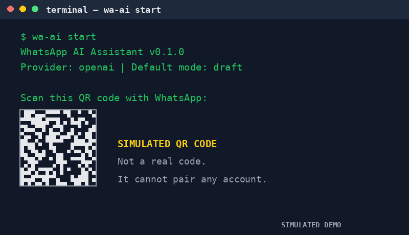

# WhatsApp AI Assistant

> **Demo (illustrated simulation — not a real WhatsApp session).**
> The GIF below is an illustrated walkthrough generated locally with a
> script. It shows a simulated QR pairing, a simulated incoming message,
> and a simulated draft approval. No real WhatsApp account, phone number,
> or message is shown.



A self-hosted gateway between your WhatsApp account and any AI model.
Pair once with a QR code, pick a provider, and decide per chat whether the
AI auto-replies, drafts for your approval, or stays silent.

> **⚠️ Read this first.** This tool uses an **unofficial WhatsApp API**
> (the WhatsApp Web protocol via Baileys). It is not affiliated with
> WhatsApp or Meta. WhatsApp may temporarily or permanently ban numbers
> that use automation. **Test on a secondary number first.** See
> [DISCLAIMER.md](DISCLAIMER.md) for the full disclaimer.

## Features

- **QR pairing** — scan once; the session is saved, restarts reconnect
  without a new scan.
- **Any AI model** — OpenAI, Anthropic (Claude), Google (Gemini), DeepSeek,
  Groq, Mistral, local Ollama, or any custom OpenAI-compatible endpoint.
- **Per-chat reply modes** — `auto`, `draft`, or `off`, set from the CLI
  without touching code.
- **Draft approval** — in `draft` mode nothing is sent until you approve
  it with `wa-ai approve-draft <id>`.
- **Human takeover** — when you reply from your own phone, the AI pauses
  in that chat for a cooldown period, so you never talk over each other.
- **Anti-ban hygiene** — typing delay, per-chat rate limits, no bulk
  sending, global pause/resume.
- **Structured logs** — every inbound, outbound, draft, and takeover event
  in JSONL.
- **Agent-friendly CLI** — agents with shell access (including Muse) can
  operate the tool through its commands.

## How it works

```
WhatsApp (Baileys, QR auth) ⇄ Router (filters, context, policy) ⇄ AI provider ⇄ Reply sender
                                                      ↓
                                        Session store, logs, config
```

1. An incoming message passes filters: allowlist/blocklist, private-only
   or groups, mention-only in groups.
2. The router resolves the chat's mode (`auto`, `draft`, `off`).
3. The active AI provider generates a reply from the system prompt plus
   recent per-chat history.
4. In `auto` mode the reply is sent (after a typing delay). In `draft`
   mode it is written to `data/drafts.jsonl` and held until approved.
   In `off` mode nothing happens.

## Prerequisites

- **Node.js 20+** and npm. Check with `node --version`.
- A WhatsApp account. **Use a secondary number for testing** (see the
  warning above).
- An API key for at least one AI provider (or a local Ollama install).

## Install

```bash
git clone https://github.com/aziz-sudrajat/WhatsApp-AI-Assistant.git
cd WhatsApp-AI-Assistant
npm install
```

Optional: make the CLI available as `wa-ai` from anywhere:

```bash
npm link
# or run everything as: node src/cli.js <command>
```

## Configure

Copy the example environment file and fill in the values you use:

```bash
cp .env.example .env
```

Set the provider and its key. Only the key matching `AI_PROVIDER` is
required:

| Provider | `AI_PROVIDER` | Key variable | Where to get the key |
| --- | --- | --- | --- |
| OpenAI | `openai` | `OPENAI_API_KEY` | https://platform.openai.com/api-keys |
| Anthropic (Claude) | `anthropic` | `ANTHROPIC_API_KEY` | https://console.anthropic.com/settings/keys |
| Google (Gemini) | `gemini` | `GOOGLE_API_KEY` | https://aistudio.google.com/apikey |
| DeepSeek | `deepseek` | `DEEPSEEK_API_KEY` | https://platform.deepseek.com/api_keys |
| Groq | `groq` | `GROQ_API_KEY` | https://console.groq.com/keys |
| Mistral | `mistral` | `MISTRAL_API_KEY` | https://console.mistral.ai/api-keys |
| Ollama (local) | `ollama` | *(none)* | https://ollama.com — run `ollama pull llama3.1` |
| Custom endpoint | `custom` | `CUSTOM_API_KEY` + `CUSTOM_BASE_URL` | Your OpenAI-compatible server |

Default models (override with `AI_MODEL`): OpenAI `gpt-4o-mini`,
Anthropic `claude-3-5-sonnet-20241022`, Gemini `gemini-2.0-flash`,
DeepSeek `deepseek-chat`, Groq `llama-3.3-70b-versatile`, Mistral
`mistral-small-latest`, Ollama `llama3.1`. Custom providers have no
default model — set `AI_MODEL`.

Optional behavior settings live in `.env` too (see `.env.example` for the
full list): `DEFAULT_MODE`, `PRIVATE_ONLY`, `MENTION_ONLY`, `ALLOWLIST`,
`BLOCKLIST`, `TAKEOVER_COOLDOWN_MIN`, `MAX_REPLIES_PER_MIN`,
`TYPING_DELAY_MS`, `HISTORY_LIMIT`.

Per-chat modes are stored in `data/config.json` (created on first run).
See `config.example.json` for the shape. You never need to edit code to
change a mode.

**Never commit your `.env` file or the `data/` directory.** They are
already in `.gitignore`. If a secret leaks, revoke it immediately.

## Pair WhatsApp (first run)

```bash
wa-ai qr
```

A QR code is printed in the terminal. On your phone, open WhatsApp →
Settings → Linked Devices → Link a Device, and scan it. On success the
session is saved under `data/auth/`, and later restarts reconnect without
a new scan.

Check the pairing without connecting:

```bash
wa-ai status
```

## Run the gateway

```bash
wa-ai start
```

The gateway connects, prints a startup warning, and runs until you press
Ctrl+C. Every event is appended to `data/logs.jsonl`.

## Reply modes

The default mode for new chats is `draft` (safe default: nothing is sent
without your approval). Change the default:

```bash
wa-ai config set defaultMode auto
```

Set a mode for one chat (chat IDs look like `1234567890@s.whatsapp.net`
for private chats or `1234567890@g.us` for groups; find them in
`data/logs.jsonl`):

```bash
wa-ai config set-mode 1234567890@s.whatsapp.net auto
wa-ai config set-mode 1234567890@g.us draft
wa-ai config set-mode 1234567890@s.whatsapp.net off
```

View the effective configuration (never prints secrets):

```bash
wa-ai config
```

## Draft approval workflow

In `draft` mode, an incoming message produces a draft and nothing is
sent. Approve it when you are ready:

```bash
wa-ai list-drafts
wa-ai approve-draft draft-1730000000000-1
```

The running gateway polls for approved drafts (every `DRAFT_POLL_MS`)
and sends them. `list-drafts` only shows pending drafts.

## Human takeover and pause

- **Takeover:** if you reply from your own phone in a chat, the AI pauses
  in that chat for `TAKEOVER_COOLDOWN_MIN` minutes (default 30). Your
  message goes out normally; the AI stays quiet.
- **Global pause/resume:**

```bash
wa-ai pause
wa-ai resume
```

## CLI reference

| Command | What it does | Connects to WhatsApp? |
| --- | --- | --- |
| `wa-ai start` | Run the gateway | Yes |
| `wa-ai qr` | Pair a new account | Yes (pairing only) |
| `wa-ai status` | Show status (provider, key, modes, drafts) | No |
| `wa-ai config` | Show effective configuration | No |
| `wa-ai config set-mode <chat> <mode>` | Set a per-chat mode | No |
| `wa-ai config set <key> <value>` | Set a config value | No |
| `wa-ai pause` / `wa-ai resume` | Globally pause / resume AI replies | No |
| `wa-ai list-drafts` | List pending drafts | No |
| `wa-ai approve-draft <id>` | Approve a draft for sending | No |
| `wa-ai help` | Show help | No |

## Troubleshooting

- **`Missing API key for provider ...`** — set the matching key variable
  in `.env` (see the provider table above).
- **QR code does not appear** — make sure the terminal is wide enough,
  then restart `wa-ai qr`. A new code is generated each attempt.
- **Logged out / session expired** — WhatsApp ended the session. Delete
  `data/auth/` and pair again with `wa-ai qr`.
- **Reconnect loop** — check your network, then check
  `data/logs.jsonl` for the last error. The gateway retries transient
  drops automatically.
- **Provider errors (401/429/500)** — 401 means a wrong or revoked key;
  429 means the provider rate-limited you (raise nothing, wait, or lower
  `MAX_REPLIES_PER_MIN`); 5xx means the provider is having trouble.
  Errors are logged, and nothing is sent to the contact.
- **AI replies to a group you did not want** — set
  `MENTION_ONLY=true` (only reply when mentioned) or add the group to
  `BLOCKLIST`, or set its mode to `off`. Mention matching strips device
  suffixes (`123:5@s.whatsapp.net` matches `123@s.whatsapp.net`), but a
  LID mention (`123@lid`) never matches a phone-number account JID.
- **AI keeps replying while you type** — that is the takeover behavior
  working in reverse: reply once from your phone and the AI pauses for
  that chat.

## Development

```bash
npm test   # unit tests (mocked fetch, fake sockets — no network, no WhatsApp)
```

The test suite covers router decisions, rate limits, takeover, all
provider request/response shapes, the draft store, config loading, and
the gateway handler with fake clients.

## Disclaimer

This tool uses an unofficial WhatsApp API and is not affiliated with
WhatsApp or Meta. Accounts using automation may be temporarily or
permanently banned. Do not use it for spam, marketing, impersonation, or
illegal activity. The software is provided as-is, without warranty. Read
[DISCLAIMER.md](DISCLAIMER.md) before running it.

## License

MIT — Copyright (c) 2026 aziz-sudrajat. See [LICENSE](LICENSE).
